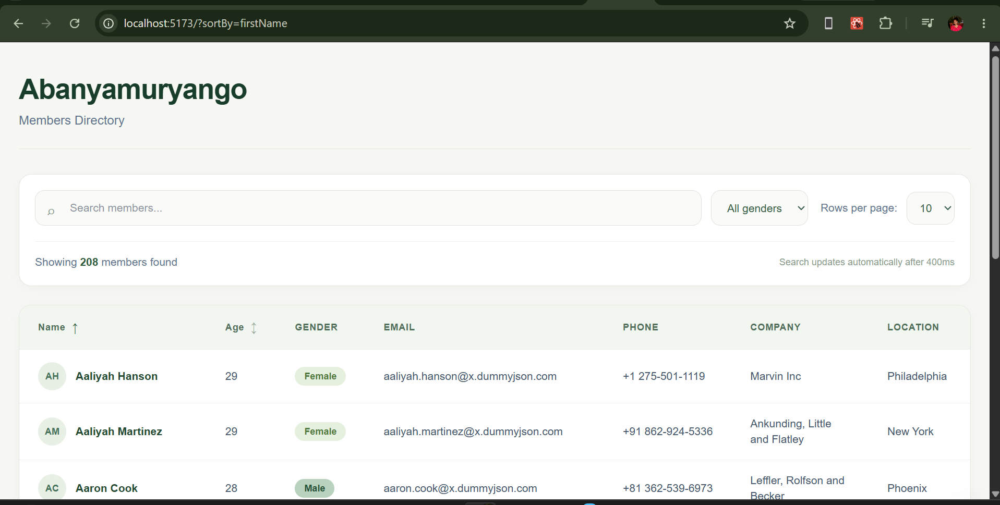
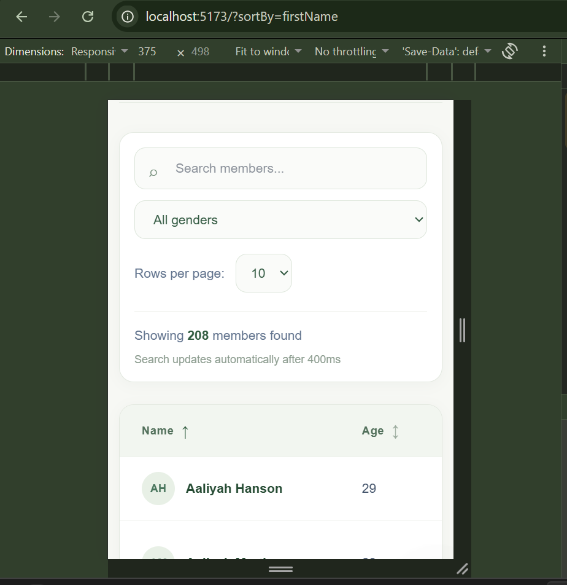
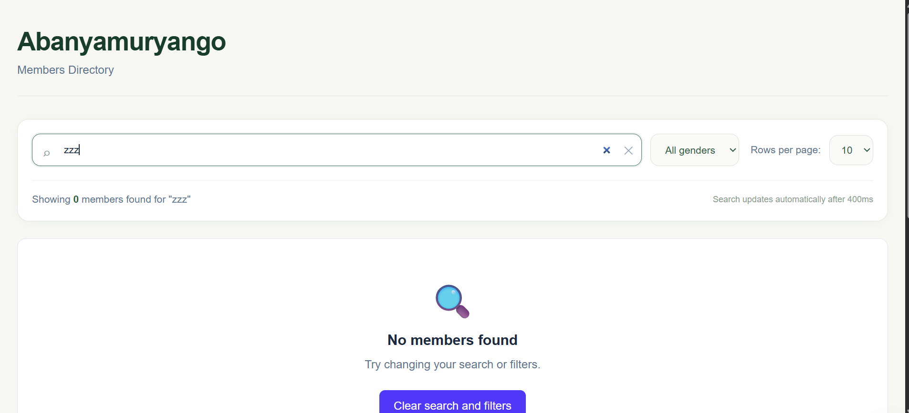
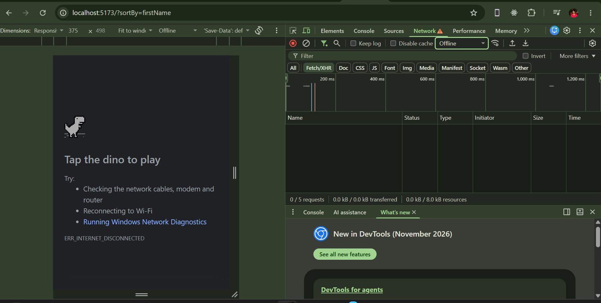

# Abanyamuryango - Members Directory

A responsive members directory built with React, Vite, Tailwind CSS, and TanStack Query. The application retrieves user information from the DummyJSON API and provides server-side pagination, sorting, search, and filtering.

## Features

- Server-side pagination with selectable page sizes (10, 20, and 50).
- Server-side sorting by name and age.
- Debounced search.
- Gender filtering.
- URL-synchronized table state for shareable links and browser navigation.
- Loading, refreshing, empty, and error states.
- Retry support when a request fails.
- Responsive and keyboard-accessible table.

## Technologies Used

- React
- Vite
- Tailwind CSS
- TanStack Query
- DummyJSON Users API
- Lucide React

## Getting Started

1. Clone the repository.
2. Install dependencies:

   ```bash
   npm install
   ```

3. Start the development server:

   ```bash
   npm run dev
   ```

4. Open the local URL displayed in your terminal.

## API

Data is retrieved from the [DummyJSON Users API](https://dummyjson.com/users).

## Responsive Design

The table uses a responsive layout with horizontal scrolling on smaller screens. This keeps the columns readable without forcing the content into an excessively narrow layout. Search and filter controls also adapt to smaller screen widths.

## Screenshots

### Desktop View



### Mobile View



### Empty State



### Error State



## Contributors

- Isaro Rubagumya Roxane

## Project

**Repository:** [members-table](https://github.com/roxaneisaro12/members-table)

**Branch:** members-table